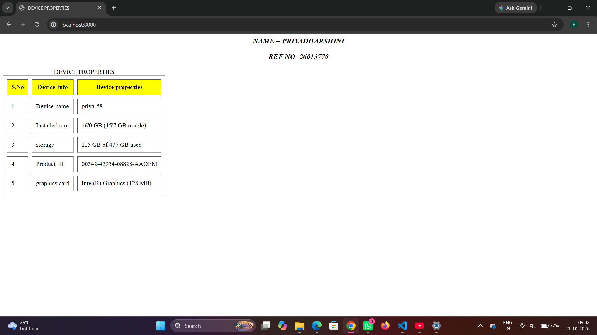
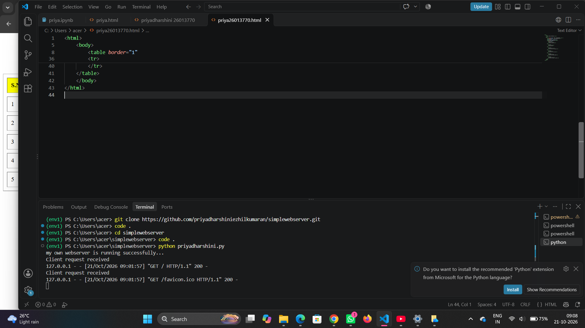

# EX01 Developing a Simple Webserver
## Date:28.09.2026

## AIM:
To develop a simple webserver to serve html pages and display the Windows Specifications of your Laptop.

## DESIGN STEPS:
### Step 1: 
HTML content creation.

### Step 2:
Design of webserver workflow.

### Step 3:
Implementation using Python code.

### Step 4:
Import the necessary modules.

### Step 5:
Define a custom request handler.

### Step 6:
Start an HTTP server on a specific port.

### Step 7:
Run the Python script to serve web pages.

### Step 8:
Serve the HTML pages.

### Step 9:
Start the server script and check for errors.

### Step 10:
Open a browser and navigate to http://127.0.0.1:8000 (or the assigned port).

## PROGRAM:
```


from http.server import HTTPServer, BaseHTTPRequestHandler
content = """
<html>
    <head>
        <title>DEVICE PROPERTIES</title>
    </head>
    <body>
        <i><h3 align="center"> NAME = PRIYADHARSHINI </h3></i>
        <i><h3 align="center"> REF NO=26013770</h3></i>
        <table border="1"
         cellspacing="10" cellpadding="10">
        <caption>DEVICE PROPERTIES</caption>
        <tr bgcolor="yellow">
            <th>S.No</th>
            <th>Device Info</th>
            <th>Device properties</th>   
        </tr>
        <tr>
            <td>1</td>
            <td>Device name</td>
            <td>priya-58</td>
        </tr>
        <tr>
            <td>2</td>
            <td>Installed ram</td>
            <td>16'0 GB (15'7 GB usable)</td>
        </tr>
        <tr>
            <td>3</td>
            <td>storage</td>
            <td>115 GB of 477 GB used</td>
        </tr>
        <tr>
            <td>4</td>
            <td>Product ID</td>
            <td>00342-42954-08828-AAOEM</td>
        </tr>
        <tr>
            <td>5</td>
            <td>graphics card</td>
            <td>Intel(R) Graphics (128 MB)</td>
        </tr>
    </table>
    </body>
</html>

"""
class myhandler(BaseHTTPRequestHandler):
    def do_GET(self):
        print("Client request received")
        self.send_response(200)
        self.send_header('content-type', 'text/html; charset=utf-8')
        self.end_headers()
        self.wfile.write(content.encode())
server_address = ('',8000)
httpd = HTTPServer(server_address,myhandler)
print("my own webserver is running successfully...")
httpd.serve_forever()
```


## OUTPUT:
webpage


webserver

## RESULT:
The program for implementing simple webserver is executed successfully.
